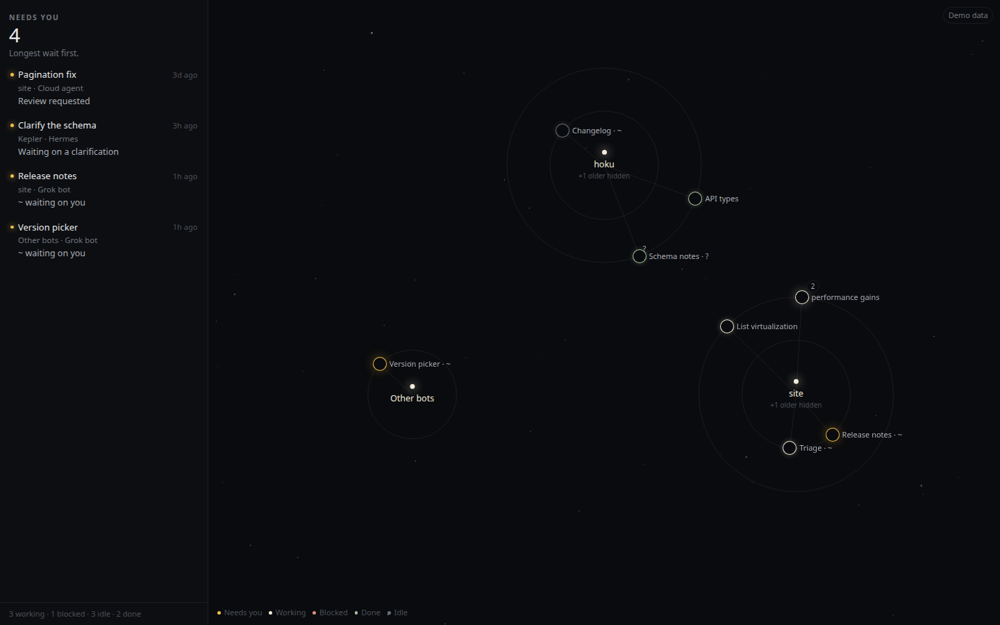

# Galaxy on the web

A browser view of the overseer, for the Linux machine where the Grok bots run. It is the same constellation. Each bot, cloud agent, pull request, issue, and Hermes session is a star. The glow is the state. The left side answers what needs you right now. The page does not send a message, approve, or comment.

## Start

From the repo:

```bash
pnpm galaxy
```

That builds the page and listens on `0.0.0.0:4730`. Open `http://<tailscale-ip>:4730/`.

Demo data is on unless you turn it off. With demo data the page uses invented fronts, does not read the bot index, and does not call Cursor, GitHub, or Hermes. It works with no tokens.

```bash
HOKU_GALAXY_DEMO=0 pnpm galaxy
```

## Environment

Tokens come from the environment only. They are not written into the page.

| Variable | Default | Meaning |
|---|---|---|
| `HOKU_GALAXY_PORT` | `4730` | Port |
| `HOKU_GALAXY_HOST` | `0.0.0.0` | Bind address. `0.0.0.0` is reachable over Tailscale |
| `HOKU_GALAXY_DEMO` | `1` | Set to `0` to read live sources |
| `HOKU_GROK_INDEX` | `/home/box/agent-data/search-index.db` | Grok message index |
| `HOKU_GROK_AGENTS` | `/home/box/agent-data/agents` | Folders that hold `profile.json` |
| `HOKU_GROK_ACTIVE_MINUTES` | `15` | How recent an assistant message must be to count as active |
| `HOKU_GALAXY_RECENT_DAYS` | `3` | Without a GitHub token, finished cloud-agent work older than this is left off the map |
| `CURSOR_API_KEY` | | Cloud agents |
| `GITHUB_TOKEN` or `GH_TOKEN` | | Pull requests, failing checks, and assigned issues |
| `HERMES_API_KEY` or `API_SERVER_KEY` | | Only if the dashboard session list asks for a key |
| `HERMES_DASHBOARD` | `http://127.0.0.1:9119` | Loopback only |
| `HERMES_API` | `http://127.0.0.1:8642` | Loopback only |

The browser receives an agent id, a name, a last timestamp, a last role, and a derived state. From chat it also receives cloud-agent ids, repository slugs, mention counts, and mention times. It does not receive message bodies.

## Grok states are guesses

The index is internal to the Grok Bot app. Its schema can change without notice, and it has no turn, tool, widget, approval, or secret-request data. Every bot state on the page is a guess, marked with `~`:

- `~ active` — the newest row is the assistant, and it is inside the active window
- `~ resting` — the newest row is the assistant, and it is older than that window
- `~ waiting on you` — the newest row is the assistant, and the text ends with `?`
- `~ unanswered` — the newest row is yours, and no assistant reply came after it

A question wins over the active window. If the newest row is yours, the bot is unanswered even when it spoke earlier.

The database is opened read-only. On Node versions that accept SQLite URIs that is `file:<path>?mode=ro`, and the connection also sets `PRAGMA query_only`. The server polls by re-reading; the page asks again every few seconds. Folders that contain `group.json` are group rooms and are skipped. Only `profile.json` is read, and only its `name`.

If the database, the profile folder, or the schema is missing or unexpected, the page says **Grok Bot data unavailable** and the other stars stay up.

The door for a bot is `grokbot://app/v1/agent?id=<agentId>`. Clicking the star opens it. A repository opens on GitHub. A cloud agent opens at `https://cursor.com/agents/<id>`.

## Projects, bots, and work

The cores are GitHub repositories. That is the same project star as the rest of the map.

Around a repository:

- **Grok bots** that mentioned it. A mention counts when a message links `github.com/<owner>/<repo>/pull|issues|tree|blob/...`, or when the bot mentions a `bc-...` cloud agent (including a `cursor.com/agents/<id>` link) and that bot mentioned the agent more than any other bot. A tie goes to the latest mention. A bot can stand on several repositories, once each, with the same link. The placement is a guess: the label keeps `~`, and the tooltip says "linked by mentions in chat". A repository mentioned only once, with no agent attached, is left out. Coordinator bots name a lot of repositories; the second mention is the bar.
- **Work**, on the outer ring. A single cloud agent is named by its pull-request title when Cursor or GitHub sent one, otherwise by the agent's title. A Cursor project is a coordinator agent: its thread agents are grouped under one star named by the coordinator's title. The count on that star opens the threads. The project is drawn when at least one thread survives the filter below.

With a GitHub token, a work item is drawn when its pull request is open, or when the run is still going (creating, running, or any status that is not finished, failed, cancelled, expired, or idle). Closed, merged, and missing pull requests are omitted unless that run is still going. Without a token, pull-request state is not used as a filter. A work item is drawn when the run is still going, or when `updatedAt` is inside `HOKU_GALAXY_RECENT_DAYS` (default 3, `now - updatedAt`). Older finished work is not drawn. The repository name carries a count such as `+37 older hidden`. That count is not a control. A repository with bots and no surviving work keeps the bots and draws no work ring. A repository with neither bots nor surviving work is omitted. There is no Unassigned cluster. An agent with no repository of its own is placed on its pull request's repository when it is drawn.

Pull-request state comes from GitHub when `GITHUB_TOKEN` or `GH_TOKEN` is set (`GET /repos/{owner}/{repo}/pulls/{n}`: `merged`, then `open` or `closed`). If there is no token, Hoku still reads a status on the Cursor run or agent when one is present (`prStatus`, `prState`, `pullRequestState`, or `pr.status`) for the `?` mark and for Needs you. It does not invent open or closed. A drawn star whose pull request nobody classified is marked `?`.

The agent's colour is the run, using the same palette as the rest of the map: running is working, finished is done, failed or error is blocked, expired or cancelled is idle. A finished run is Needs you only when that open pull request is already Needs you from GitHub (review requested, or changes requested). An open pull request that nobody asked you to review does not.

Bots that sit on no visible repository stay in a small **Other bots** ring, so a bot that is waiting on you is still on the map and still in Needs you. GitHub and Hermes still feed Needs you. They are not drawn as their own clusters.

The Cursor list is followed with `nextCursor` (`limit` 100, `includeArchived=false`) until it ends or **200** agents, whichever comes first, and at most 10 pages. The list, the agent records, and the pull-request states are cached for a minute. Rings show eight stars. A count shows the rest; click it to open the ring.



## What it looks like

The left column is what needs you. Amber is the only colour that means waiting.


Selecting a Grok bot shows the guess. The `~` means the index does not know about turns or approvals.


If the index or the profile folder is missing, or the table is not the one this server knows, that source says so and the rest of the page stays up.


The server does not read `box-secrets.json`, `host-secrets.json`, `gateway.json`, `chrome-cookie-seed.json`, or any `store.db`. It does not call the local gateway on port 1340.
