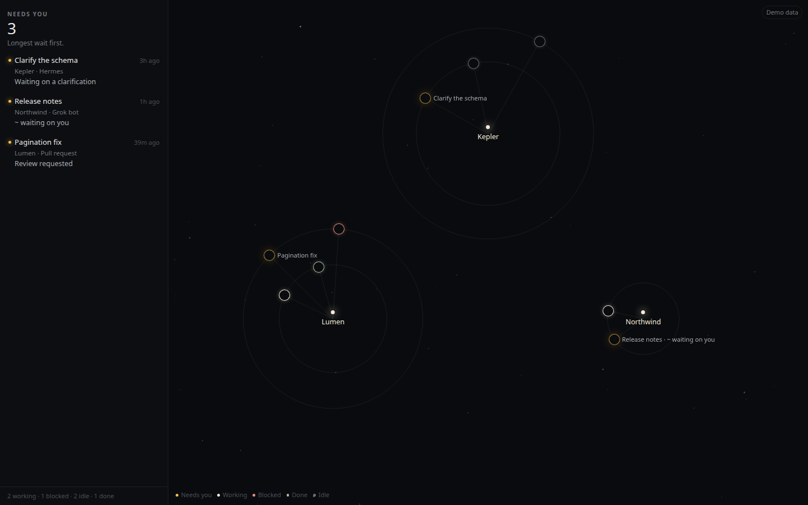
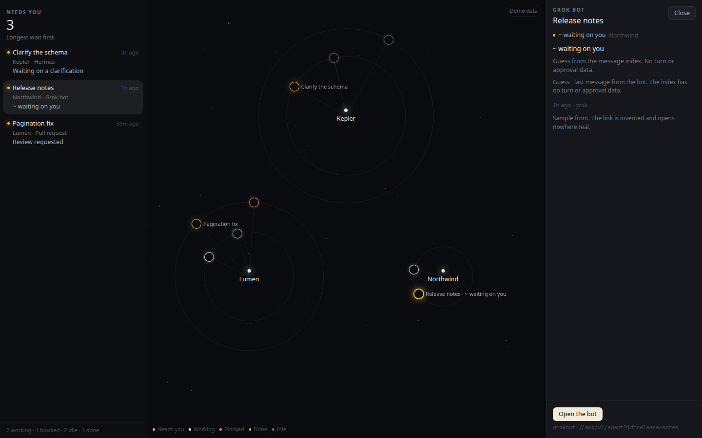
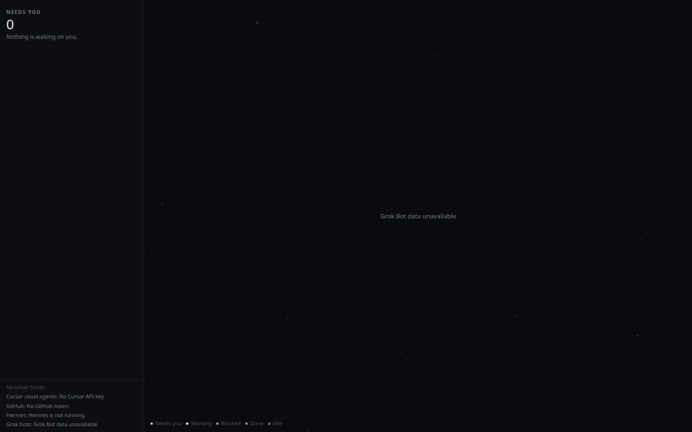

# Galaxy on the web

A browser view of the overseer, for the Linux machine where the Grok bots run. It is the same constellation. Each bot, cloud agent, pull request, issue, and Hermes session is a star. The glow is the state. The left side answers what needs you right now. The page does not send a message, approve, or comment.

## Start

From the repo:

```bash
pnpm galaxy
```

That builds the page and listens on `0.0.0.0:4730`. Open `http://<tailscale-ip>:4730/`.

Demo data is on unless you turn it off. With demo data the page uses invented fronts, does not read the bot index, and does not call Cursor, GitHub, or Hermes. It works with no tokens.

```bash
HOKU_GALAXY_DEMO=0 pnpm galaxy
```

## Environment

Tokens come from the environment only. They are not written into the page.

| Variable | Default | Meaning |
|---|---|---|
| `HOKU_GALAXY_PORT` | `4730` | Port |
| `HOKU_GALAXY_HOST` | `0.0.0.0` | Bind address. `0.0.0.0` is reachable over Tailscale |
| `HOKU_GALAXY_DEMO` | `1` | Set to `0` to read live sources |
| `HOKU_GROK_INDEX` | `/home/box/agent-data/search-index.db` | Grok message index |
| `HOKU_GROK_AGENTS` | `/home/box/agent-data/agents` | Folders that hold `profile.json` |
| `HOKU_GROK_ACTIVE_MINUTES` | `15` | How recent an assistant message must be to count as active |
| `CURSOR_API_KEY` | | Cloud agents |
| `GITHUB_TOKEN` or `GH_TOKEN` | | Pull requests, failing checks, and assigned issues |
| `HERMES_API_KEY` or `API_SERVER_KEY` | | Only if the dashboard session list asks for a key |
| `HERMES_DASHBOARD` | `http://127.0.0.1:9119` | Loopback only |
| `HERMES_API` | `http://127.0.0.1:8642` | Loopback only |

The browser receives an agent id, a name, a last timestamp, a last role, and a derived state. It does not receive message bodies.

## Grok states are guesses

The index is internal to the Grok Bot app. Its schema can change without notice, and it has no turn, tool, widget, approval, or secret-request data. Every bot state on the page is a guess, marked with `~`:

- `~ active` — the newest row is the assistant, and it is inside the active window
- `~ resting` — the newest row is the assistant, and it is older than that window
- `~ waiting on you` — the newest row is the assistant, and the text ends with `?`
- `~ unanswered` — the newest row is yours, and no assistant reply came after it

A question wins over the active window. If the newest row is yours, the bot is unanswered even when it spoke earlier.

The database is opened read-only. On Node versions that accept SQLite URIs that is `file:<path>?mode=ro`, and the connection also sets `PRAGMA query_only`. The server polls by re-reading; the page asks again every few seconds. Folders that contain `group.json` are group rooms and are skipped. Only `profile.json` is read, and only its `name`.

If the database, the profile folder, or the schema is missing or unexpected, the page says **Grok Bot data unavailable** and the other stars stay up.

The door for a bot is `grokbot://app/v1/agent?id=<agentId>`. Clicking the star opens it. Cloud agents open on cursor.com, and pull requests open on GitHub.

## What it looks like

The left column is what needs you. Amber is the only colour that means waiting.



Selecting a Grok bot shows the guess. The `~` means the index does not know about turns or approvals.



If the index or the profile folder is missing, or the table is not the one this server knows, that source says so and the rest of the page stays up.



The server does not read `box-secrets.json`, `host-secrets.json`, `gateway.json`, `chrome-cookie-seed.json`, or any `store.db`. It does not call the local gateway on port 1340.
